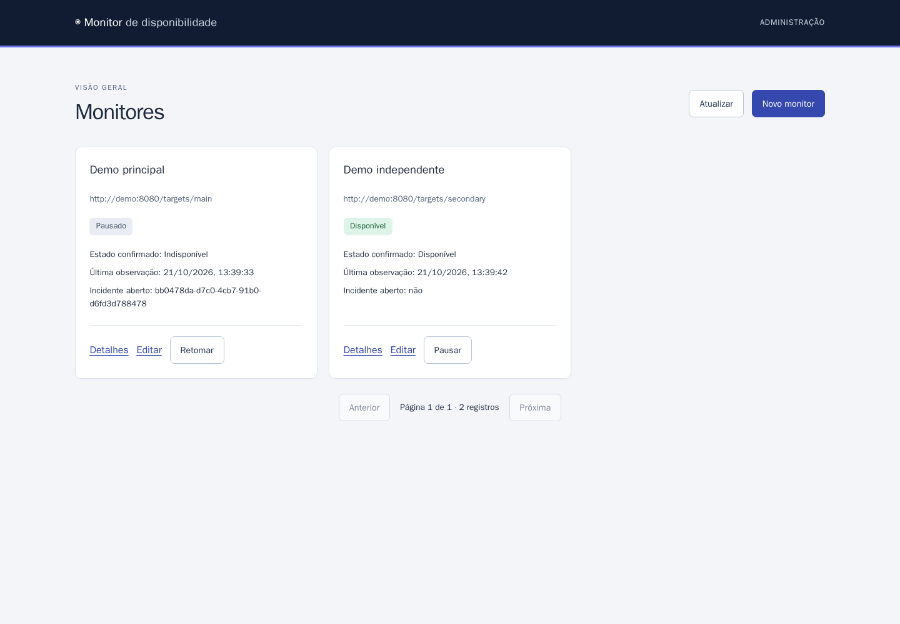
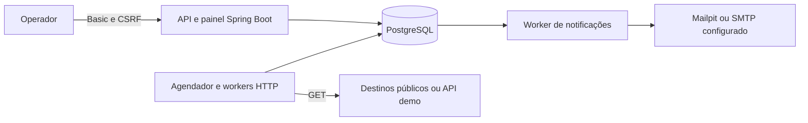

# Monitor de disponibilidade

Monitor de APIs e sites que verifica endpoints HTTP/HTTPS, identifica quedas e recuperações e envia alertas por e-mail. Um painel administrativo reúne o estado dos monitores, as verificações realizadas, os incidentes e as tentativas de notificação.

O projeto foi construído como um portfólio backend com execução local reproduzível. O foco está no comportamento diante de falhas: confirmar uma queda antes de alertar, preservar registros após reinícios, retomar notificações pendentes e impedir que um alvo lento bloqueie os demais.


## Navegação

- [O que o projeto faz](#o-que-o-projeto-faz)
- [Início rápido](#início-rápido)
- [Como usar](#como-usar)
- [Experimentar quedas e recuperações](#experimentar-quedas-e-recuperações)
- [Como foi feito](#como-foi-feito)
- [Configuração](#configuração)
- [Operação local](#operação-local)
- [Testar](#testar)
- [Specs, testes e limites](#specs-testes-e-limites)
- [Diagnóstico](#diagnóstico)

## O que o projeto faz

O monitor atende a quem precisa acompanhar endpoints sem verificar cada um manualmente. Para cada destino, o operador define o código HTTP esperado, o intervalo, o timeout e quantas falhas ou sucessos consecutivos confirmam uma mudança de estado.

| Funcionalidade | Comportamento |
| --- | --- |
| Administração | Cadastrar, editar, listar, pausar e retomar monitores |
| Verificação HTTP | Executar GET com timeout total e comparação do status esperado |
| Confirmação de queda | Abrir um único incidente após o número configurado de falhas consecutivas |
| Confirmação de recuperação | Encerrar o incidente após o número configurado de sucessos consecutivos |
| Alertas por e-mail | Registrar a intenção de envio, tentar a entrega e manter o histórico de tentativas |
| Histórico e indicadores | Consultar verificações, incidentes, notificações, taxa de sucesso por amostragem e latência |
| Continuidade | Preservar dados e retomar trabalho pendente após reinícios |
| Operação | Expor probes, métricas administrativas, logs estruturados e retenção configurável |

A versão local suporta **um operador, uma instância da aplicação e até 100 monitores**, incluindo os pausados. O limite de cadastro não garante que qualquer combinação de intervalos e timeouts seja atendida; consulte a [capacidade medida](#capacidade-medida).

## Início rápido

### 1. Preparar o ambiente

Instale Git e Docker com Compose. No Docker Desktop, use contêineres Linux e mantenha o daemon iniciado. O primeiro build precisa de acesso à internet para baixar imagens e dependências.

**Java, Maven, Node e navegador de testes executam nos contêineres.** Não é necessário instalá-los no host. PowerShell 5.1 ou 7 é necessário apenas para os roteiros automatizados de demonstração e validação.

```sh
git clone https://github.com/AugustoEngel010/monitor-disponibilidade.git
cd monitor-disponibilidade
```

### 2. Configurar as credenciais

Copie o arquivo de exemplo para `.env`:

```powershell
# Windows PowerShell
Copy-Item .env.example .env
```

```sh
# Linux/macOS
cp .env.example .env
```

Edite `.env` e substitua os valores de `ADMIN_USERNAME` e `ADMIN_PASSWORD` por credenciais locais. Os placeholders são recusados e impedem o startup. Mantenha as demais variáveis com os valores do exemplo para executar a demonstração padrão. `.env` é ignorado pelo Git.

### 3. Iniciar os serviços

```sh
docker compose up --build
```

O Compose constrói a aplicação a partir do código e inicia quatro serviços: **aplicação, PostgreSQL, Mailpit e API de demonstração**. Um serviço auxiliar, `demo-seed`, aguarda a prontidão e cadastra dois monitores locais. Ele termina com código zero após concluir a carga inicial.

| Serviço | Endereço padrão | Uso |
| --- | --- | --- |
| Painel | http://localhost:8080/ | Autenticar com as credenciais de `.env` |
| Mailpit | http://localhost:8025/ | Consultar os e-mails capturados localmente |
| API de demonstração | http://localhost:8081/control | Consultar os modos dos dois alvos |
| Prontidão da aplicação | http://localhost:8080/actuator/health/readiness | Conferir se a aplicação está pronta |

As portas 8080, 8081, 8025 e 1025 precisam estar livres; todas as portas publicadas estão vinculadas ao loopback do host. Para iniciar em segundo plano, use `docker compose up --build -d`. Confira a carga inicial com `docker compose logs demo-seed`.

## Como usar

### Acompanhar os monitores de demonstração

Ao abrir o painel, informe o usuário e a senha configurados. A lista contém **Demo principal** e **Demo independente**, criados automaticamente. Com os alvos saudáveis, ambos passam a mostrar **Disponível** após a primeira observação.

Clique em **Detalhes** para consultar resumo, verificações, incidentes e notificações. Os históricos têm filtros e paginação; o período informado delimita as consultas. Use **Atualizar** ou reabra a página para obter os dados atuais: o painel não pressupõe atualização automática.

O SMTP padrão aponta para o Mailpit. Assim, os alertas ficam disponíveis na interface local, inclusive os destinados a `portfolio@example.test`; não são encaminhados a caixas postais externas.

### Cadastrar um destino próprio

Clique em **Novo monitor**, preencha os campos e selecione **Salvar monitor**:

| Campo | Exemplo | Regra |
| --- | --- | --- |
| Nome | API de pedidos | 1 a 100 caracteres |
| URL | `https://example.org/health` | HTTP/HTTPS, sem credenciais, query ou fragmento |
| Intervalo | 60 segundos | De 10 a 3600 segundos |
| Timeout | 5 segundos | De 1 a 30 segundos, menor que o intervalo |
| Código HTTP esperado | 200 | Um código de 200 a 599, comparado exatamente |
| Falhas para confirmar queda | 3 | De 1 a 10 falhas consecutivas |
| Sucessos para confirmar recuperação | 2 | De 1 a 10 sucessos consecutivos |
| Destinatário dos alertas | `ops@example.org` | Um endereço de e-mail |

Use um endpoint público sob seu controle para verificações reais. Destinos privados são bloqueados, com uma exceção explícita para a API demo. Dentro do Compose, os alvos locais são `http://demo:8080/targets/main` e `http://demo:8080/targets/secondary`: **localhost dentro do contêiner não é o host**.

Com um incidente aberto, é possível alterar nome e destinatário, mas mudanças de URL ou política são recusadas para preservar a relação entre incidente e destino. As notificações já criadas mantêm seu destinatário original.

### Entender os estados

O painel separa três informações: se o monitor está ativo, qual foi o estado confirmado e se ainda há observação recente.

| Indicação | Significado |
| --- | --- |
| Sem observação corrente | Ainda não há evidência válida para o período ativo atual |
| Disponível | Há uma observação recente e o estado confirmado é UP |
| Confirmando queda | Existem falhas, mas o limiar de confirmação ainda não foi atingido |
| Indisponível | A queda foi confirmada e existe um incidente aberto |
| Confirmando recuperação | Já houve sucesso, mas faltam confirmações para encerrar o incidente |
| Pausado | O operador suspendeu as verificações; o estado e o incidente são preservados |
| Dados antigos | A última observação perdeu o frescor; não há evidência recente para afirmar a condição atual |

O limite de frescor é `2 × intervalo + timeout`. Pausar ou deixar de coletar dados não confirma recuperação. Ao retomar um monitor, uma nova observação é necessária para restabelecer a evidência corrente.

## Experimentar quedas e recuperações

Os dois alvos locais têm modos independentes. No PowerShell, altere o principal para retornar HTTP 503:

```powershell
Invoke-RestMethod -Method Post http://localhost:8081/control/main/error
```

Atualize o painel a cada intervalo. Os monitores de demonstração usam intervalo de **10s**, timeout de **2s**, **3 falhas** para queda e **2 sucessos** para recuperação. A terceira falha confirma a queda, abre um incidente e gera uma notificação. Falhas seguintes preservam o mesmo incidente.

Volte ao modo saudável:

```powershell
Invoke-RestMethod -Method Post http://localhost:8081/control/main/healthy
```

O primeiro sucesso inicia a confirmação de recuperação; o segundo encerra o incidente e gera o aviso de recuperação. Consulte os dois e-mails no Mailpit e os horários nos detalhes do monitor.

Para observar um timeout, use o modo lento, que aguarda **15s antes de responder os cabeçalhos**:

```powershell
Invoke-RestMethod -Method Post http://localhost:8081/control/main/slow
```

O principal registra TIMEOUT enquanto o alvo independente continua sendo verificado. Os mesmos controles existem para `secondary`. Em terminais com curl, use, por exemplo, `curl -X POST http://localhost:8081/control/main/error`.

### Executar a demonstração completa

O [roteiro detalhado](docs/demo.md) demonstra também reinício com incidente aberto e notificação pendente, retomada do envio, concorrência, pausa e período sem dados recentes. Para executar todas as etapas com verificações automáticas e capturas reais:

```powershell
powershell -NoProfile -ExecutionPolicy Bypass -File scripts/demo.ps1
```

No PowerShell 7: `pwsh -File scripts/demo.ps1`. O script usa um projeto separado, `monitor-portfolio`, com banco novo, SMTP local e as credenciais fictícias `portfolio-operator` / `portfolio-local-only`. Painel em http://localhost:18080, Mailpit em http://localhost:18025; portas adicionais 18081 e 11025. A execução leva alguns minutos porque respeita os intervalos e retries reais.

Os serviços permanecem disponíveis para inspeção. Snapshots, logs e oito capturas ficam em `.validation/demo/`. Para repetir, consulte no roteiro as opções de projeto novo ou descarte dos dados da execução anterior; as assertions exigem um histórico inicial vazio.

<details>
<summary>Ver pausa e ausência de dados recentes no fluxo real</summary>




</details>

## Como foi feito

### Tecnologias e organização

| Camada | Tecnologias |
| --- | --- |
| Backend | Java 21, Spring Boot 3.5.16, Spring Security, JDBC e Actuator |
| Persistência | PostgreSQL 17.6 e migrações Flyway |
| Painel | HTML, CSS e módulos JavaScript servidos pela aplicação |
| Build e ambiente | Maven em build com múltiplas etapas, runtime JRE e Docker Compose |
| Qualidade | JUnit, Testcontainers com PostgreSQL real, ArchUnit, Checkstyle e Playwright |
| Demonstração | API auxiliar em Node 22 e Mailpit para captura SMTP |

A aplicação é um **monólito modular**: mantém uma única implantação, com responsabilidades separadas por domínio. A API de demonstração é um auxiliar local separado do backend Java.



| Módulo em `src/main/java/br/com/monitor` | Responsabilidade |
| --- | --- |
| `administration` | Configuração, validação e ciclo de vida dos monitores |
| `monitoring` | Agendamento persistente, execução HTTP e registro dos resultados |
| `incident` | Confirmação de transições e manutenção dos incidentes |
| `notification` | Envio SMTP, tentativas e retomada de pendências |
| `query` | Consultas de histórico e composição dos indicadores |
| `operation` | Retenção, eventos operacionais e métricas |
| `security` | Autenticação administrativa, CSRF e acesso aos probes |

O painel está em `src/main/resources/static`; as migrações, em `src/main/resources/db/migration`. Os auxiliares locais ficam em `config/demo` e os testes de navegador em `config/panel`.

### Decisões que sustentam o comportamento

**Transações e outbox.** A aplicação confirma estado, incidente, transição e intenção de notificação na mesma transação. O worker envia o e-mail depois, fora dela. Isso permite retomar um envio pendente sem perder a transição que o originou.

**Idempotência e histórico durável.** Identificadores de execução, restrições de unicidade e registros de aplicação impedem que um resultado repetido reaplique os mesmos efeitos. Reinícios preservam configurações, incidentes, resultados e trabalho de notificação.

**Concorrência limitada.** O agendador reserva tentativas no PostgreSQL e usa um número limitado de workers, quatro por padrão. Não sobrepõe verificações do mesmo monitor nem reproduz cada intervalo perdido após uma interrupção. Excesso de carga aparece como atraso de agendamento.

**Separação entre evidência e estado.** Pausa administrativa, estado confirmado e frescor são dimensões independentes. Falta de dados não gera sucesso fictício; taxa de sucesso por amostragem não é apresentada como uptime temporal.

**Segurança de administração e destinos.** HTTP Basic protege painel e API; escritas exigem token CSRF da mesma sessão. O executor valida destinos, bloqueia endereços privados, não segue redirects e mantém validação TLS. A exceção local autoriza somente a origem exata configurada em `MONITOR_DEMO_ORIGIN`.

**Desenvolvimento orientado por especificações.** O trabalho foi dividido nas entregas MON-01 a MON-12, com critérios de aceite, decisões, tarefas, testes derivados dos requisitos e revisão independente usando a skill `tlc-spec-driven` do Tech Leads Club. As specs e os pareceres ficam versionados em [`.specs/`](.specs), com [rastreabilidade de requisitos e testes](docs/traceability.md).

## Configuração

[`.env.example`](.env.example) contém a lista completa de variáveis e comentários. Variáveis exportadas no terminal prevalecem sobre `.env`.

| Grupo | Variáveis principais | Padrão local |
| --- | --- | --- |
| Operador | `ADMIN_USERNAME`, `ADMIN_PASSWORD` | Obrigatórias, sem credenciais padrão válidas |
| Portas | `APP_PORT`, `DEMO_PORT`, `SMTP_UI_PORT`, `SMTP_LOCAL_PORT` | 8080, 8081, 8025 e 1025 |
| Banco | `DB_NAME`, `DB_USER`, `DB_PASSWORD` | PostgreSQL local com valores de desenvolvimento |
| Destino local permitido | `MONITOR_DEMO_ORIGIN` | `http://demo:8080` no arquivo de exemplo |
| Agendamento | `MONITOR_CHECK_CONCURRENCY`, `MONITOR_SCHEDULER_ENABLED`, `MONITOR_SCHEDULER_POLL_MS` | 4 workers, habilitado, polling de 250ms |
| Notificações | `MONITOR_NOTIFICATIONS_ENABLED`, `MONITOR_NOTIFICATIONS_POLL_MS` | Habilitadas, polling de 250ms |
| SMTP | `SMTP_HOST`, `SMTP_PORT`, `SMTP_FROM` | `smtp`, 1025, `monitor@example.org` |
| Autenticação e TLS SMTP | `SMTP_USERNAME`, `SMTP_PASSWORD`, `SMTP_AUTH`, `SMTP_STARTTLS`, `SMTP_SSL` | Credenciais vazias; autenticação e TLS desabilitados no Mailpit local |
| Timeouts SMTP | `SMTP_CONNECT_TIMEOUT_MS`, `SMTP_READ_TIMEOUT_MS`, `SMTP_WRITE_TIMEOUT_MS` | 5000, 3000 e 5000ms |
| Retenção | `MONITOR_RETENTION_ENABLED`, `MONITOR_RETENTION_DAYS`, `MONITOR_RETENTION_BATCH_SIZE`, `MONITOR_RETENTION_POLL_MS` | Habilitada, 30 dias, lotes de 1000, polling de uma hora |
| JVM | `JAVA_TOOL_OPTIONS` | `-XX:MaxRAMPercentage=75.0` |
| Rede dos testes | `TESTCONTAINERS_HOST_OVERRIDE` | `host.docker.internal` |

O usuário administrativo aceita até 128 caracteres, sem dois-pontos ou controles; a senha aceita até 72 bytes UTF-8. Para trocar as credenciais, edite `.env` e recrie a aplicação:

```sh
docker compose up -d --force-recreate app
```

Basic continua sendo exigido a cada requisição; o cookie de sessão usado pelo CSRF não substitui a autenticação. Só GET/HEAD dos três endpoints de health são públicos. Para clientes da API, consulte o [contrato administrativo](docs/monitor-api.md) e o [exemplo de cliente com Basic e CSRF](config/demo/client.mjs).

Deixar `MONITOR_DEMO_ORIGIN` vazia mantém destinos privados bloqueados. Para operar sem a demonstração, mantenha a variável vazia e inicie apenas os serviços necessários, por exemplo `docker compose up --build -d app db smtp`. O ambiente padrão é local; exposição fora do host exige HTTPS e uma configuração de implantação própria.

## Operação local

```sh
# Iniciar em segundo plano
docker compose up --build -d

# Conferir serviços, inclusive a conclusão do seed
docker compose ps -a

# Acompanhar logs
docker compose logs -f app db smtp demo demo-seed

# Reiniciar a aplicação
docker compose restart app

# Parar e remover contêineres, preservando os dados
docker compose down
```

O volume `postgres-data` preserva o banco e `smtp-data` preserva as mensagens capturadas. Ambos pertencem ao projeto Compose. **`docker compose down --volumes` apaga esses dados e o cache Maven do projeto**; não é o comando habitual de parada. Credenciais de inicialização do PostgreSQL só são aplicadas a um volume vazio, e migrações já aplicadas não devem ser editadas.

Para executar novamente a carga inicial, espere o seed de startup terminar e use:

```sh
docker compose run --rm --no-deps demo-seed
```

O seed identifica os monitores por URL e preserva IDs, pausa e incidentes existentes. Execuções devem ocorrer em série; configuração incompatível ou identidades duplicadas provocam erro, sem sobrescrever registros. Recriar o contêiner demo restaura seus modos para healthy, sem apagar o histórico no PostgreSQL.

O build usa apenas o código-fonte, sem JAR prévio no host. A imagem de runtime executa com UID 10001 e contém JRE e JAR; ferramentas de build e socket Docker ficam fora dela.

## Testar

Os comandos de validação usam contêineres e propagam código diferente de zero em falhas.

```sh
# Testes unitários, integração com PostgreSQL real e Checkstyle
docker compose run --build --rm tests

# Contratos da API demo e idempotência do seed
docker compose run --build --rm --no-deps demo-seed node --test server.test.mjs seed.test.mjs
```

Os testes de navegador usam aplicação e banco próprios, sem portas no host e sem acesso ao volume do operador:

```sh
docker compose -p monitor-panel-tests --profile panel-tests down
docker compose -p monitor-panel-tests --profile panel-tests run --use-aliases --build --rm panel-tests
docker compose -p monitor-panel-tests --profile panel-tests down
```

Para conferir startup, autenticação, rotação de credenciais, migrações e persistência:

```powershell
powershell -NoProfile -ExecutionPolicy Bypass -File scripts/validate-compose.ps1
```

Para validar build e execução em uma cópia limpa, sem `target` ou `.env` do operador:

```powershell
powershell -NoProfile -ExecutionPolicy Bypass -File scripts/validate-clean.ps1
```

Os dois scripts usam projetos descartáveis e removem somente os recursos criados para seus testes. O segundo mantém a cópia do checkout em `.validation/` para inspeção. A [CI](.github/workflows/ci.yml) executa suíte Java, build runtime, contratos demo, smoke, navegador e demonstração completa por Docker, além de preservar relatórios em caso de falha.

| Evidência local da entrega MON-12 | Resultado |
| --- | --- |
| Java | 482 testes: 169 unitários e 313 de integração |
| Navegador | 50 testes Playwright |
| API demo e seed | 2 testes |
| Smoke operacional | 37 verificações aprovadas |
| Demonstração e checkout limpo | Aprovados; dois incidentes encerrados e quatro mensagens capturadas |
| Revisão independente | 8/8 critérios aprovados; três regressões injetadas detectadas |

Os resultados são da validação local registrada, sem inferir sucesso de CI remota. Consulte o [parecer independente](.specs/features/mon-12-demonstracao/validation.md), os [comandos e resultados](.specs/features/mon-12-demonstracao/evidence.md) e os [snapshots da demonstração](.specs/features/mon-12-demonstracao/demo-evidence.json).

Relatórios Java e Checkstyle ficam em `target/`; HTML, JUnit e traces do navegador em `.validation/panel/`; demonstração em `.validation/demo/`. O serviço `tests` recebe acesso ao socket Docker para criar bancos Testcontainers descartáveis. A rede usa `host.docker.internal` com `host-gateway`; esse acesso ao daemon é restrito ao contêiner de testes, e o runtime não o recebe.

## Specs, testes e limites

### Documentação de referência

| Assunto | Documento |
| --- | --- |
| Roteiro manual e automatizado | [Demonstração local](docs/demo.md) |
| Cadastro, edição e ciclo de vida | [API administrativa](docs/monitor-api.md) |
| Timeout, classificações e segurança de rede | [Verificações HTTP](docs/http-checks.md) |
| Concorrência, reservas e retomada | [Agendamento](docs/scheduling.md) |
| Confirmação de queda e recuperação | [Incidentes](docs/incidents.md) |
| Outbox, SMTP e retries | [Notificações](docs/notifications.md) |
| Histórico, filtros e indicadores | [Consultas](docs/queries.md) |
| Probes, métricas, logs e retenção | [Operação](docs/operations.md) |
| Requisitos e cobertura de testes | [Rastreabilidade](docs/traceability.md) |
| Decisões e estado da entrega | [STATE.md](.specs/STATE.md) |
| Entregas e critérios de aceite | [Backlog](.specs/task/monitor-disponibilidade-tasks.md) e [specs](.specs/features) |

### Capacidade medida

O [cenário de capacidade MON-11](docs/capacity/README.md) verificou **100 monitores**, com concorrência **4**, em uma mistura de respostas rápidas, lentas, HTTP 503 e timeouts. Foram registradas **285 verificações em aproximadamente 60s**, sem sobreposição por monitor e sem ultrapassar quatro verificações simultâneas.

O atraso de agendamento chegou a **20,63s**, com média de **10,97s**. Essa carga **não sustentou o intervalo de 10s** com os recursos medidos: aplicação, runner e alvos em 2 CPUs/2GiB; PostgreSQL em 1 CPU/512MiB. A medição caracteriza esse cenário local e não estabelece SLA ou capacidade universal. Parâmetros, valores exatos, dados brutos e reprodução estão no guia de capacidade.

### Limites da versão

- Uma instância da aplicação e um operador; a instância anterior deve estar parada antes de outra assumir o mesmo banco.
- Verificações por GET até os cabeçalhos, sem validação de corpo, redirects, query na URL ou autenticação no destino.
- Alertas somente por e-mail, com até cinco tentativas. ACCEPTED significa aceitação pelo SMTP, não recebimento na caixa postal. Confirmação incerta pode produzir mensagens duplicadas com o mesmo Message-ID.
- Sem exclusão de monitores, fechamento manual de incidentes, múltiplas organizações ou monitoramento distribuído.
- Taxa de sucesso calculada por amostras. Pausas e lacunas não comprovam disponibilidade ou indisponibilidade contínua.
- Retenção padrão de 30 dias, preservando incidentes abertos, pendências, evidências necessárias e recibos de idempotência. Isso não garante uso de disco constante.
- Ambiente validado com Docker em contêineres Linux; Docker Windows containers, daemon remoto e Podman não foram validados. Publicação e hospedagem ficam para uma evolução posterior.

## Diagnóstico

| Sintoma | O que conferir |
| --- | --- |
| Docker não conecta | Inicie o daemon, confirme `docker info` e use contêineres Linux |
| Aplicação encerra no startup | Consulte `docker compose logs app db`; confira credenciais administrativas e banco |
| Monitores demo não aparecem | Consulte `docker compose logs demo-seed`; espere a prontidão e confira a configuração |
| Porta ocupada | Altere `APP_PORT`, `DEMO_PORT`, `SMTP_UI_PORT` ou `SMTP_LOCAL_PORT` |
| DESTINATION_BLOCKED | Confira a URL interna e a origem exata em `MONITOR_DEMO_ORIGIN` |
| HTTP 401 ou 403 | Confira Basic; para escritas de clientes API, renove token e cookie da mesma sessão |
| Notificação pendente | Veja as tentativas e `nextAttemptAt`; confira `docker compose logs smtp app` |
| Dados antigos no painel | Confira scheduler, última observação e atraso em `nextCheckAt`; ausência de execução não é recuperação |
| Testcontainers não alcança PostgreSQL | Confira socket, rota `host.docker.internal`/`host-gateway` e firewall |
| Histórico ausente | Confira o limite de retenção; aumentar o prazo não restaura registros removidos |

Os probes públicos retornam somente status. Métricas em `/actuator/metrics` exigem Basic; logs JSON usam IDs de correlação. O [guia operacional](docs/operations.md) detalha as consultas para diagnóstico.
