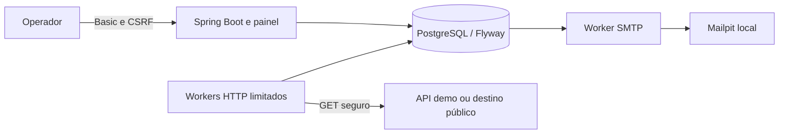

# Monitor de disponibilidade

Monitor HTTP para quem opera APIs e precisa reconhecer quedas sem consultar cada serviço manualmente. Registra verificações, confirma falhas consecutivas, abre um incidente e envia e-mail. Confirma a recuperação antes de encerrar o incidente. PostgreSQL preserva o trabalho após reinícios.

O MVP tem um operador, uma instância e até 100 monitores. O painel distingue **pausa administrativa**, **estado confirmado** e **frescor da observação**. Taxa de sucesso por amostragem não é uptime temporal.


Funcionalidades: cadastro, edição, pausa e retomada; executor HTTP/HTTPS com timeout total e proteção de destinos; concorrência limitada; incidentes e outbox transacionais; retries SMTP; histórico paginado; indicadores; probes, métricas e retenção. A demonstração usa dois alvos controláveis e Mailpit, sem enviar para destinatários reais.

Stack: Java 21, Spring Boot 3.5.16, Spring Security, JDBC, PostgreSQL 17.6 e Flyway. Painel HTML/CSS/JavaScript servido pelo Spring. Maven, JUnit, Testcontainers, Checkstyle e Playwright executam em contêineres. Node 22 executa apenas os auxiliares de demonstração e navegador.

## Executar localmente

Pré-requisitos: Git, Docker Engine Linux com Compose ou Docker Desktop em modo Linux, daemon ativo e acesso às imagens. Para o roteiro automatizado, PowerShell 5.1 ou 7. Não precisa instalar JDK, Maven, Node ou navegador no host. Reserve recursos para PostgreSQL, JVM e navegador; os testes criam bancos descartáveis adicionais. Portas padrão livres: 8080, 8081, 8025 e 1025.

Na raiz do checkout, copie a configuração:

```powershell
Copy-Item .env.example .env
```

Em Linux/macOS: `cp .env.example .env`. Edite `.env` e substitua os placeholders de `ADMIN_USERNAME` e `ADMIN_PASSWORD`. Sem valores válidos a aplicação recusa startup. Não publique `.env`; ele está ignorado pelo Git.

```sh
docker compose up --build
```

O comando compila a aplicação do código, inicia PostgreSQL, Mailpit e API demo. `demo-seed` espera a prontidão e cria dois monitores pela API com Basic e CSRF; termina com exit 0. Confira sua conclusão com `docker compose logs demo-seed`.

| Acesso | Endereço padrão |
| --- | --- |
| Painel, login Basic com as credenciais de `.env` | http://localhost:8080/ |
| Readiness pública, corpo mínimo | http://localhost:8080/actuator/health/readiness |
| E-mails capturados, destinatário `portfolio@example.test` | http://localhost:8025/ |
| Controle e estado da API demo | http://localhost:8081/control |
| Alvos | http://localhost:8081/targets/main e /targets/secondary |

Os monitores usam **http://demo:8080**, a origem dentro da rede Compose. Não use localhost como URL do alvo. `.env.example` habilita explicitamente `MONITOR_DEMO_ORIGIN=http://demo:8080`. A variável vazia bloqueia destinos privados; a exceção libera somente esquema/host/porta exatos, preservando a política MON-05. Em execução sem demo, deixe-a vazia e inicie apenas os serviços necessários. A API demo não tem autenticação própria; suas portas no host estão limitadas a 127.0.0.1 e seus controles não fazem parte da API administrativa.

Para repetir o seed, sem criar monitores adicionais:

```sh
docker compose run --rm --no-deps demo-seed
```

Execute seeds em série. A identidade é a URL; duplicações ou configuração divergente fazem o seed falhar sem sobrescrever registros. Pausa e incidentes existentes são preservados. Os dados iniciais usam I=10s, T=2s, F=3, R=2, status esperado 200. Os modos da demo são voláteis e voltam a healthy quando o contêiner é recriado; o histórico permanece no PostgreSQL.

## Configuração

A lista completa está em [.env.example](.env.example). Variáveis do shell prevalecem sobre `.env`.

| Variáveis | Uso / padrão |
| --- | --- |
| ADMIN_USERNAME, ADMIN_PASSWORD | Obrigatórias; usuário até 128 caracteres, sem colon/controles; senha até 72 bytes UTF-8; placeholders recusados |
| APP_PORT, DEMO_PORT | Portas loopback 8080, 8081 |
| DB_NAME, DB_USER, DB_PASSWORD | Banco local; defaults descartáveis; senha só é aplicada ao inicializar volume vazio |
| JAVA_TOOL_OPTIONS | `-XX:MaxRAMPercentage=75.0` |
| MONITOR_DEMO_ORIGIN | Origem exata opcional; vazia no Compose sem `.env` |
| MONITOR_CHECK_CONCURRENCY | 4, intervalo 1..16; uma instância |
| MONITOR_SCHEDULER_ENABLED, MONITOR_SCHEDULER_POLL_MS | true, 250ms positivo |
| MONITOR_NOTIFICATIONS_ENABLED, MONITOR_NOTIFICATIONS_POLL_MS | true, 250ms; polling 1..60000ms |
| SMTP_HOST, SMTP_PORT, SMTP_FROM | smtp, 1025, monitor@example.org; Mailpit local sem relay |
| SMTP_USERNAME, SMTP_PASSWORD, SMTP_AUTH | Vazios, vazios, false |
| SMTP_STARTTLS, SMTP_SSL | false; não combinar ambos |
| SMTP_CONNECT_TIMEOUT_MS, SMTP_READ_TIMEOUT_MS, SMTP_WRITE_TIMEOUT_MS | 5000, 3000, 5000; cada um 1..60000ms |
| SMTP_UI_PORT, SMTP_LOCAL_PORT | 8025 e 1025 no loopback |
| MONITOR_RETENTION_ENABLED, MONITOR_RETENTION_DAYS | true e 30 dias (1..3650) |
| MONITOR_RETENTION_BATCH_SIZE, MONITOR_RETENTION_POLL_MS | 1000 (1..10000); 3600000ms (1000..86400000) |
| TESTCONTAINERS_HOST_OVERRIDE | host.docker.internal, somente testes |

Para rotacionar credenciais, altere `.env` e execute `docker compose up -d --force-recreate app`. Basic é exigido a cada requisição. Cookie de sessão serve ao CSRF e não mantém autenticação antiga. Escritas exigem Basic, cookie e token de `GET /api/admin/csrf`. O painel faz esse fluxo; o [cliente demo](config/demo/client.mjs) mostra um exemplo executável. Só GET/HEAD dos três health endpoints são públicos; métricas, APIs, página e assets são protegidos. Use HTTPS se futuramente expuser a aplicação fora do host.

## Demonstração completa

O [roteiro](docs/demo.md) detalha as etapas manuais e automatizadas. Para executar assertions e capturas reais em projeto separado, com banco novo:

```powershell
powershell -NoProfile -ExecutionPolicy Bypass -File scripts/demo.ps1
```

Com PowerShell 7, use `pwsh -File scripts/demo.ps1`. O roteiro demora alguns minutos, pois espera intervalos e retries reais. Usa o projeto `monitor-portfolio`, portas 18080/18081/18025/11025 e as credenciais **fictícias locais** `portfolio-operator` / `portfolio-local-only`, independentes do operador de `.env`.

Ele verifica: sucesso → confirmação de queda → um incidente → SMTP → confirmação de recuperação → encerramento; nova queda com SMTP parado → PENDING → reinício → mesma intenção enviada; timeout de um alvo enquanto outro conclui; pausa preservando incidente; scheduler desligado e evidência STALE; recuperação final. Relatórios e imagens ficam em `.validation/demo/`, com logs. Os serviços permanecem disponíveis para inspeção em http://localhost:18080 e http://localhost:18025.

O roteiro exige volume novo e falha diante de histórico prévio. Para repetir, pare o projeto anterior e use outro nome em `-ProjectName monitor-portfolio-2` (as portas são as mesmas), ou apague explicitamente os dados descartáveis:

```sh
docker compose -p monitor-portfolio down --volumes
```

Isso **apaga os volumes do projeto indicado**; não use no projeto com dados que deseja guardar. O fluxo normal preserva volumes:

```sh
docker compose up --build -d
docker compose ps -a
docker compose logs -f app db smtp demo demo-seed
docker compose restart app
docker compose down
```

`postgres-data` mantém configurações, verificações, incidentes e outbox após restart e down/up. `smtp-data` preserva as mensagens capturadas pelo Mailpit. Migrações aplicadas não devem ser editadas. `down --volumes` apaga esses dados e o cache Maven do projeto. `docker compose build app` constrói só a aplicação, sem exigir credenciais nem JAR no host. O runtime usa UID 10001, JRE e JAR, sem Maven, javac ou socket Docker.


## Arquitetura



Monólito modular: `administration` controla configuração e ciclo; `monitoring` agenda tentativas duráveis e executa HTTP; `incident` aplica resultados e confirma transições; `notification` processa outbox; `query` lê snapshots; `operation` fornece retenção, eventos e métricas; `security` protege a fronteira. Bootstrap em `br.com.monitor`, painel em `resources/static`. [ArchitectureTest](src/test/java/br/com/monitor/ArchitectureTest.java) impede dependências de produção em bibliotecas de teste.

Estado, incidente, transição e intenção confirmam na mesma transação. SMTP ocorre fora dela. UUIDs, índices e recibos evitam reaplicações locais. Em confirmação SMTP incerta pode haver entrega duplicada com Message-ID estável; não há exactly-once entre banco e SMTP. A instância anterior precisa estar parada antes de iniciar outra sobre o mesmo banco.

## Testar

```sh
docker compose run --build --rm tests
docker compose run --build --rm --no-deps demo-seed node --test server.test.mjs seed.test.mjs
```

A suíte Java executa `mvn clean verify`, Surefire, Failsafe com PostgreSQL real e Checkstyle. Baseline MON-11: **482 Java (169 unitários + 313 integrações)** e **50 casos de navegador**. Resultados MON-12 nas [evidências](.specs/features/mon-12-demonstracao/evidence.md). Falhas retornam exit diferente de zero; relatórios são copiados mesmo em falha para `target/surefire-reports`, `target/failsafe-reports` e `target/checkstyle-result.xml`.

Testes de navegador em banco separado/tmpfs, sem portas host:

```sh
docker compose -p monitor-panel-tests --profile panel-tests down
docker compose -p monitor-panel-tests --profile panel-tests run --use-aliases --build --rm panel-tests
docker compose -p monitor-panel-tests --profile panel-tests down
```

JUnit, HTML e traces ficam em `.validation/panel/`. O smoke verifica configuração administrativa, autenticação, rotação, migrações, SMTP e persistência:

```powershell
powershell -NoProfile -ExecutionPolicy Bypass -File scripts/validate-compose.ps1 -NoBuild
```

Execute `docker compose build app` antes de `-NoBuild`, ou omita a opção. O smoke usa projeto temporário próprio e limpa seus recursos. A [CI](.github/workflows/ci.yml) usa Docker para suíte, build, smoke e navegador; execução remota não foi observada.

Para validar startup, seed repetido e persistência após down/up em uma cópia limpa das alterações atuais, sem `target` ou `.env` do operador: `powershell -NoProfile -ExecutionPolicy Bypass -File scripts/validate-clean.ps1`. O script usa portas aleatórias, salva `.validation/mon12-clean.json` e remove somente os contêineres e volumes que criou. A cópia permanece em `.validation/` para inspeção.

Somente `tests` recebe `/var/run/docker.sock`, concedendo controle sobre o daemon para Testcontainers. Usa contêineres irmãos com portas aleatórias, Ryuk e `host.docker.internal:host-gateway`; Linux Engine precisa permitir essa rota. O runtime não recebe socket. Testes não usam o banco persistente do operador. Docker Windows containers, daemon remoto e Podman não foram validados.

## Specs, testes e limites

O [mapa de requisitos e testes](docs/traceability.md) liga MON-01 a MON-12 às specs, decisões e suites. [STATE.md](.specs/STATE.md) registra as decisões e o estado da entrega; o [backlog](.specs/task/monitor-disponibilidade-tasks.md) mantém IDs de origem. Contratos detalhados: [administração](docs/monitor-api.md), [HTTP](docs/http-checks.md), [agendamento](docs/scheduling.md), [incidentes](docs/incidents.md), [notificações](docs/notifications.md), [consultas](docs/queries.md) e [operação/retenção](docs/operations.md).

Na [medição MON-11](docs/capacity/README.md), 100 monitores com C=4 produziram **285 verificações em 60,070333095s**, sem sobreposição. Atraso máximo **20,634817s**, média **10,967730218s**. A mistura de timeouts e alvos lentos **não sustentou I=10s** com os recursos medidos (runner/app/alvos em 2 CPUs/2GiB; PostgreSQL 1 CPU/512MiB). É uma amostra desse harness, sem promessa de SLA. Recursos, resultados brutos, fase de retries e reprodução estão no guia.

Limitações: operador e executor únicos; GET até cabeçalhos, sem corpo, redirects, headers de autenticação ou query na URL; somente e-mail; até cinco tentativas; ACCEPTED é aceitação SMTP, não caixa postal. Sem exclusão de monitores ou fechamento manual. Retenção padrão de 30 dias preserva cadeias abertas/pendentes e recibos, portanto não garante disco constante. Lacunas e pausas não provam saúde ou indisponibilidade contínua. MON-01 continua proposta histórica; contratos usados foram concretizados nas specs posteriores. Publicação e hospedagem ficam para outra entrega.

## Diagnóstico

| Sintoma | Conferir / ação |
| --- | --- |
| Docker não conecta | Iniciar Docker Desktop/Engine e confirmar `docker info`; usar contêineres Linux |
| App sai durante startup | `docker compose logs app db`; preencher credenciais válidas e conferir banco |
| Seed falha | `docker compose logs demo-seed`; aguardar readiness; conferir autenticação e configuração divergente |
| Porta ocupada | Alterar APP_PORT/DEMO_PORT/SMTP_UI_PORT/SMTP_LOCAL_PORT; roteiro usa portas próprias |
| DESTINATION_BLOCKED | Usar origem interna exata `http://demo:8080`; manter proteção MON-05 |
| 401 / 403 | Conferir Basic; para escrita renovar token e cookie da mesma sessão, sem repetir automaticamente |
| Notificação pendente | Consultar tentativas e `docker compose logs smtp app`; respeitar nextAttemptAt e cinco tentativas |
| Dados antigos | Conferir scheduler, logs, nextCheckAt e idade > 2I+T; ausência não é recuperação |
| Testcontainers inacessível | Conferir socket, Docker Linux, host.docker.internal/host-gateway e firewall |
| Histórico ausente | Conferir watermark; aumentar prazo não restaura dados apagados |

Métricas exigem Basic em `/actuator/metrics`; probes públicos mostram somente status. Logs JSON usam IDs de correlação. Veja [operação](docs/operations.md) para diagnóstico detalhado.
